# X-HEEP IDE (Alpha)

VS Code extension for developing software on [X-HEEP](https://github.com/esl-epfl/x-heep), in simulation and on
FPGA: create a project, write an app, then build, run and debug it, without leaving the editor.

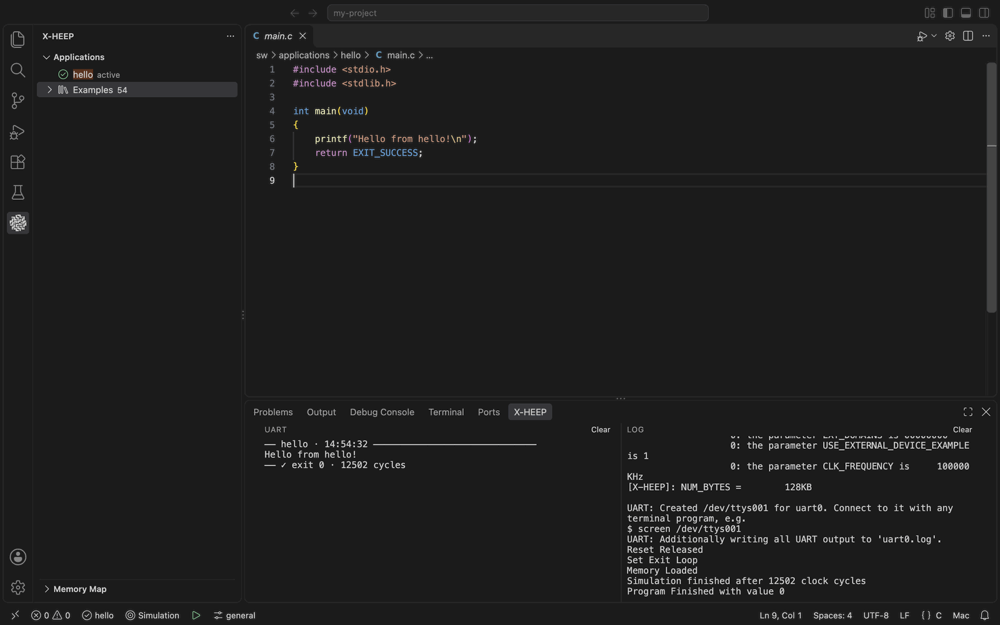

## Getting started

Ten steps, from an empty folder to an app running on the FPGA. Steps 1 to 6 take you to your first app running in
simulation.

### 1. Before you start

- **Linux or macOS.** On Windows, use [WSL](https://learn.microsoft.com/windows/wsl/install): when you create a
  project, the extension offers to connect the window to WSL.
- **The X-HEEP tools**: the Python environment, a RISC-V toolchain and Verilator, as in
  [X-HEEP's setup guide](https://x-heep.readthedocs.io/en/latest/GettingStarted/Setup.html). Missing some? Go on
  anyway: step 3 helps you install them, or reopens the project in the X-HEEP container, where all of them are
  preinstalled.

### 2. Create a project

Open an empty folder in VS Code and click the X-HEEP icon in the activity bar.

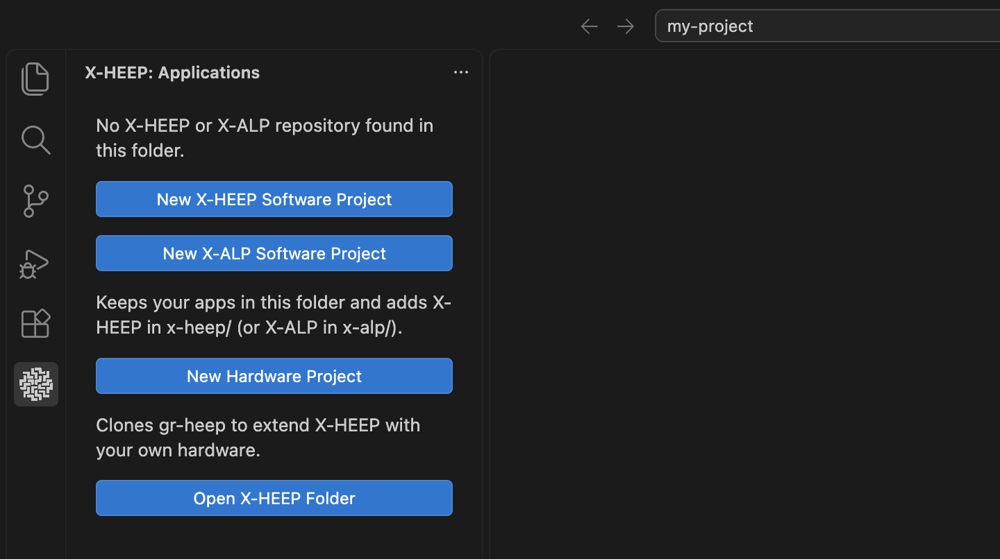

- **New X-HEEP Software Project**: your apps stay in this folder, in your own repo, with X-HEEP in `x-heep/`.
- **New X-ALP Software Project**: the same for [X-ALP](#x-alp).
- **New Hardware Project**: a new repo from gr-heep, to add your own hardware to X-HEEP (see
  [Hardware projects](#hardware-projects)).
- **Open X-HEEP Folder**: open an X-HEEP clone. The extension works there too.

A software project asks where X-HEEP comes from: a git submodule at the X-HEEP commit tested with the extension,
or a link to a clone you already have.

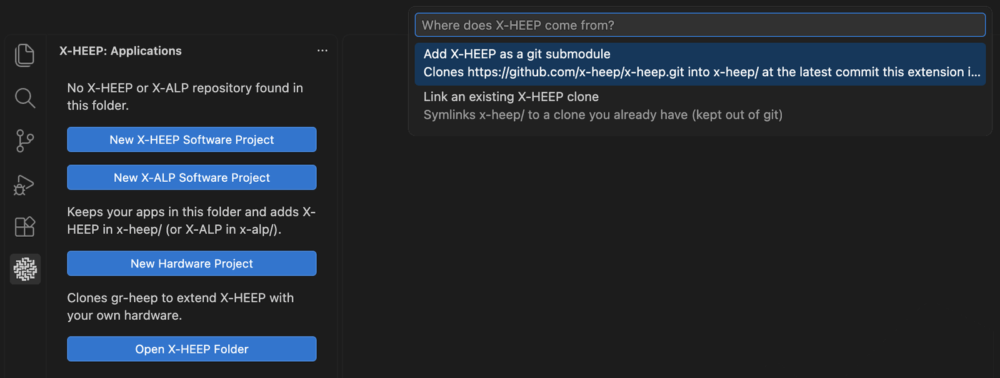

The project opens with a first app, `hello`, in `sw/applications/hello`.

### 3. Check the tools

When the project opens, the extension checks the Python environment, the toolchain, Verilator and verible. When
something is missing, a notification says so. **Show Details** lists each problem with what to do about it, and
**Open Setup Guide** opens X-HEEP's.

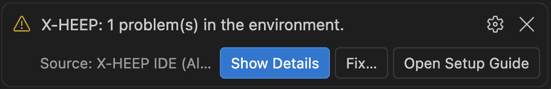

**Fix…** walks you through the tools that need it:

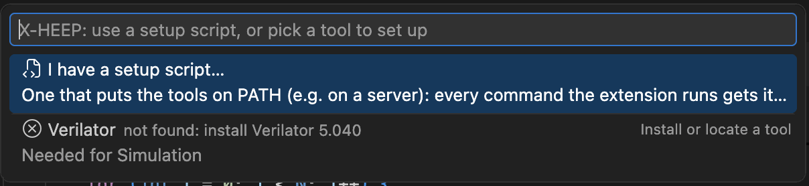

- **Setup script**: on a server where a script puts the tools on `PATH`, point the extension to it.
- **Install or locate** each missing tool, or follow its section of X-HEEP's setup guide and check again.
- **Use the X-HEEP container instead** (Docker, or WSL on Windows): all the tools are preinstalled there, for
  simulation (no FPGA).

Run **X-HEEP: Check Environment** from the Command Palette at any time. When all is fine, it says so and offers
**Change a Tool…** to use, say, another toolchain.

### 4. Write your app

The **Applications** view lists your apps, and the X-HEEP examples under **Examples**. Click **+** to create an
app: it goes in `sw/applications/<name>/main.c`.

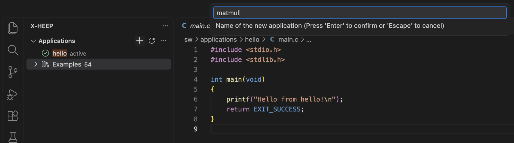

Open a file of an app and it becomes the **active** app: Build, Run and Debug act on it. Hover an app for its own
buttons: New File, Build, Run and Debug.

### 5. Choose where the app runs

The status bar shows, from left to right: the active app, the run mode, the Run button and the platform
configuration. Click any of them to change it.


The **run mode** says where Run and Debug send the app:

- **Simulation**: on the RTL model of X-HEEP, with Verilator (or Questasim). No hardware needed: start here.
- **FPGA · JTAG**: loads the app into X-HEEP's RAM through the JTAG adapter. Run runs it, Debug opens GDB.
- **FPGA · Flash**: writes the app to the SPI flash, and X-HEEP boots it by itself, as the chip would.

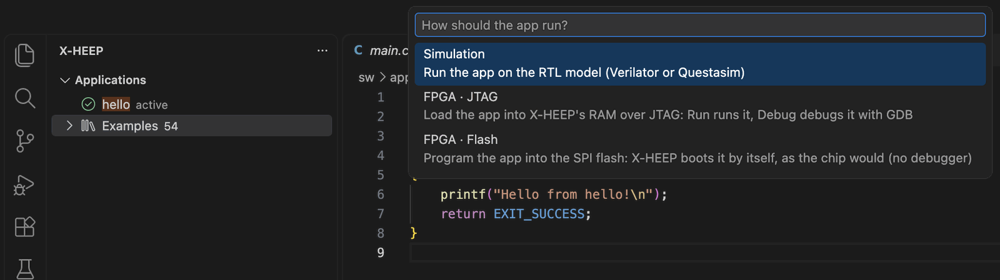

The **platform configuration** is the X-HEEP you build for: CPU, bus, memory and peripherals. Pick one of
X-HEEP's, or create your own, as Python code or with the editor (see step 9).

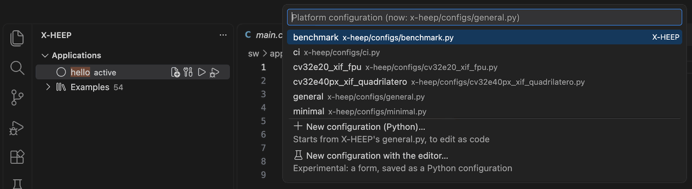

### 6. Build and run

Click the Run button (▷) in the status bar. The first time, Run generates the platform and builds the Verilator
model of X-HEEP: this takes a few minutes, once. Then it builds the app and runs it. Next time, only the app is
rebuilt, and the model only when you change the configuration or the RTL.

The Run button tells you the state of the model: a green ▶ when it is ready, a 🔧 when Run will build it first,
a red ✗ when its build failed. The icon next to the app name tells the state of the app's build.

The **X-HEEP** tab in the bottom panel (the screenshot at the top) shows the app's UART output on the left, closed
by its exit code and the cycles it took, and the log of what the extension runs on the right: mcu-gen, model and
app builds, the simulator, OpenOCD. Both are also in the *X-HEEP UART* and *X-HEEP* Output channels.

Builds by hand count too: after a `make verilator-build` or a `make app` in a terminal, the status bar shows the
model and the app as built.

### 7. Debug

Set a breakpoint, hover the app in the Applications view and click Debug (or run **X-HEEP: Debug Application**).

- In **Simulation**, the extension builds a model with JTAG (once, a few more minutes), starts it with OpenOCD and
  attaches GDB.
- In **FPGA · JTAG**, it loads the app through the JTAG adapter and attaches GDB.

Then use VS Code's debugger as usual: step, look at variables, the call stack and the registers.

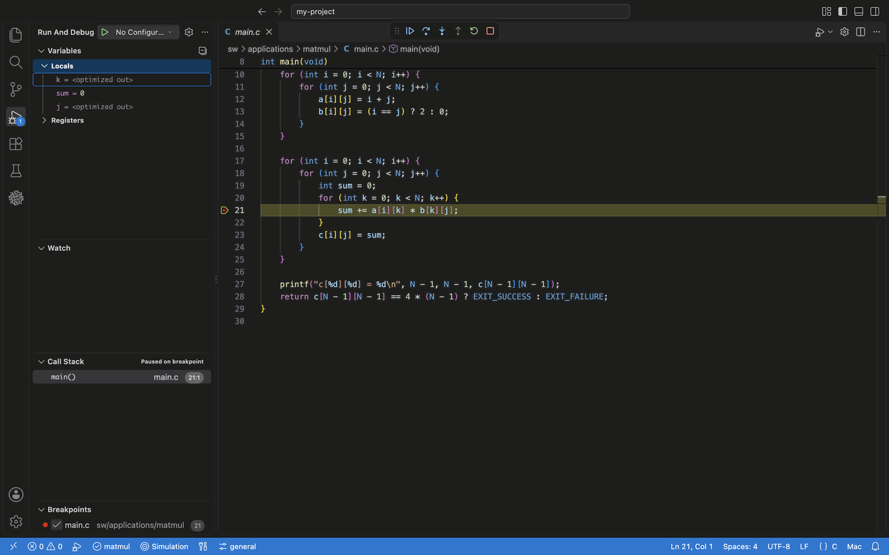

### 8. When something goes wrong

The extension reads the build and run output and tells you what went wrong and what to do about it: apps that do
not fit in memory, functions that need an operating system (`sleep`, `pthread_*`), stack overflows, exceptions,
and programs stuck on the board. Compiler errors go to the Problems panel.

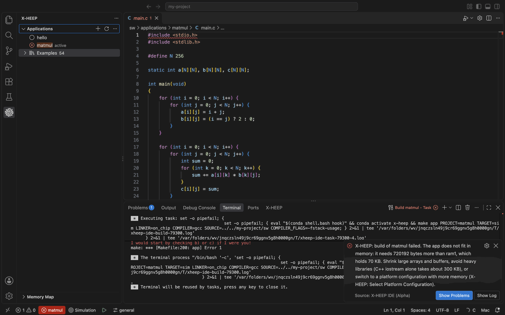

### 9. Explore and change the platform

The **Memory Map** view, under Applications, shows the RAM, the address regions and the peripherals of the active
platform, down to their registers and fields. **Copy Address** copies the C define of a register
(`UART_START_ADDRESS + UART_CTRL_REG_OFFSET`).

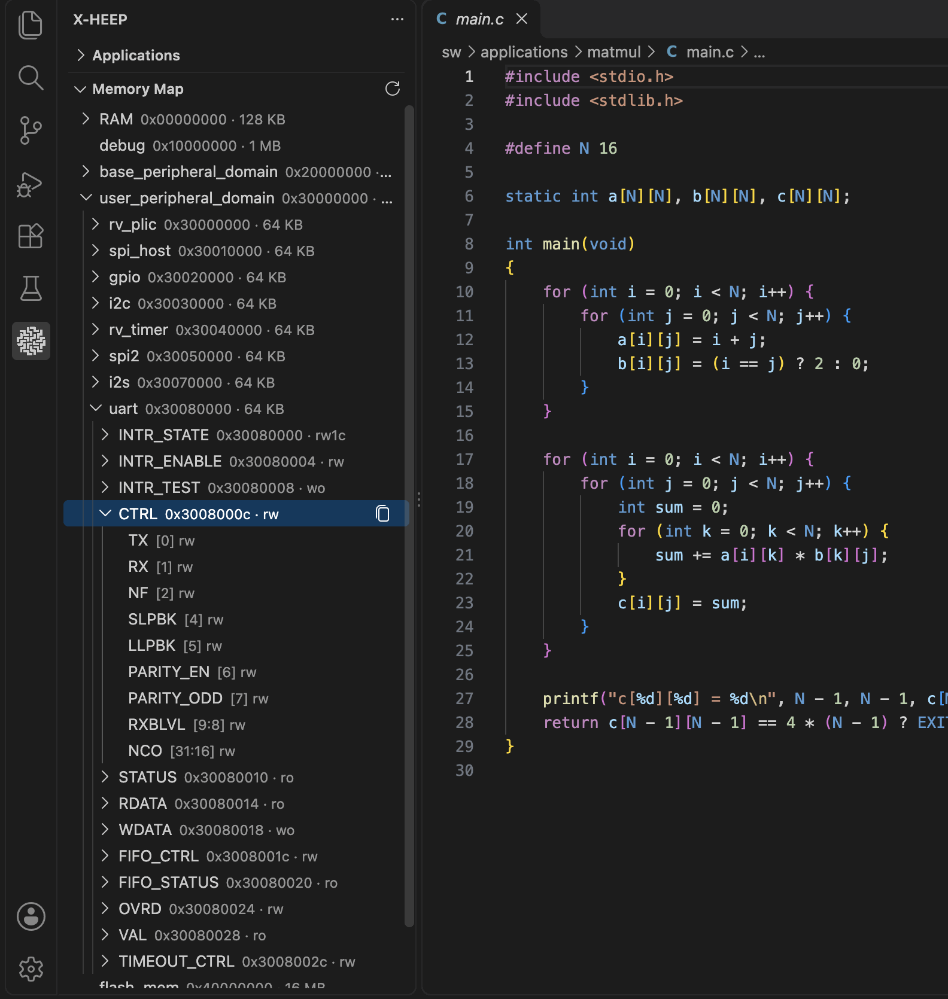

To change the platform, click the configuration in the status bar and pick **New configuration with the
editor…** (experimental). The editor is a form for CPU, bus, memory and peripherals, and shows how the RAM is
split between code, data, heap and stack. **Save as…** writes a small Python file on top of the configuration you
started from, and never edits the original. Prefer code? **New configuration (Python)…** starts from X-HEEP's
`general.py`.

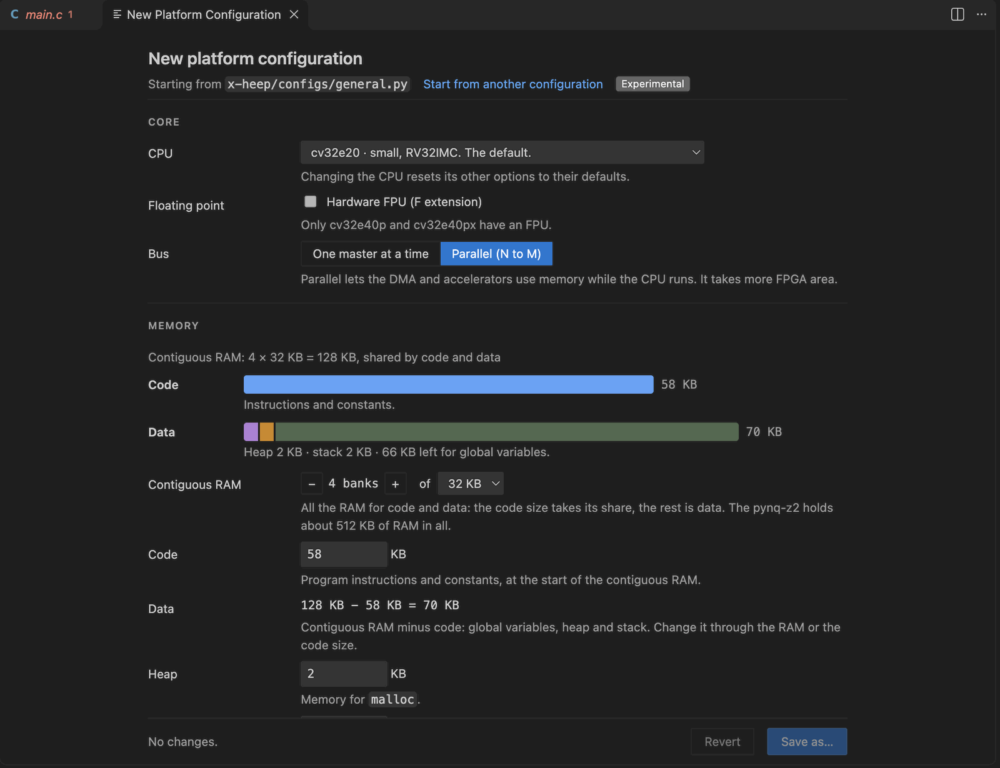

### 10. Run on the FPGA

Officially supported boards: **PYNQ-Z2** and **AUP-ZU3**.

1. Set `xheep.fpgaBoard` to your board, and plug in the board, its UART and the JTAG adapter.
2. Set `xheep.bitstream` to the X-HEEP bitstream (`.bit`) you were given. With Vivado installed, you can build one
   instead with **X-HEEP: Build Bitstream**.
3. Pick **FPGA · JTAG** or **FPGA · Flash** in the status bar. The extension checks the board, the adapter and
   their permissions, and says what is missing.
4. Click Run. The extension loads the bitstream when needed (on the PYNQ-Z2 through OpenOCD, no Vivado needed),
   then the app. The board's UART shows in the X-HEEP tab, as in simulation.

The extension warns you when the active configuration does not match the hardware of the bitstream. To talk to the
board yourself, run **X-HEEP: Open Serial Monitor**.

## Hardware development

For changes to the X-HEEP RTL:

- **Model kept up to date, only when needed**: Build regenerates the platform only when it is missing or older than
  its configuration, and Run also rebuilds the simulation model only when it is missing or older than an RTL file in
  `hw/` or `tb/`. What you generate or build by hand (`make mcu-gen`, `make verilator-build`) counts, so a mixed flow
  works. A platform generated by hand shows as **manual** in the status bar: the extension uses it as it is and never
  regenerates it, until you pick a configuration (or run **Regenerate Platform**). The Memory Map then shows the
  platform as generated, read from its C header. Verilator and Questasim errors,
  and warnings outside vendored IPs, go to the Problems panel.
- **Waveforms**: **Open Waveform** opens the `waveform.fst` of the last Verilator run in
  [Surfer](https://marketplace.visualstudio.com/items?itemName=surfer-project.surfer), or in GTKWave.
- **SystemVerilog editing** with the [Verible](https://marketplace.visualstudio.com/items?itemName=chipsalliance.verible)
  extension: lint, go to definition across modules (the extension writes `verible.filelist` from the model's
  files), and formatting on save as X-HEEP's `util/format-verible` does, only in the folders it covers
  (`xheep.formatRtlOnSave`).
- **Memory Map** view: RAM, address regions, peripherals, and their registers and fields from the regtool
  descriptions. Copy Address copies the C define (`UART_START_ADDRESS + UART_CTRL_REG_OFFSET`).
- **App regression** in the Testing view: runs the apps on the simulation model of the active platform. An app
  passes when it exits with 0. Apps X-HEEP's own app test leaves out are skipped, unless you run them one by one.

## Software-only projects

Run **X-HEEP: New X-HEEP Software Project** in an empty folder to keep your apps in your own repo, with X-HEEP added
as a git submodule (or a link to an existing clone) in `x-heep/`.
**Update X-HEEP** moves that submodule to the latest X-HEEP commit tested with the extension, or to `main`.

## Hardware projects

Run **X-HEEP: New Hardware Project** to start a new repo from [gr-heep](https://github.com/x-heep/gr-heep), to
extend X-HEEP with your own hardware. It is renamed after its folder: `my-chip` gives `hw/my-chip/my_chip.sv`,
module `my_chip`, core `x-heep:systems:my-chip`. The extension works in gr-heep and
its forks (X-HEEP vendored in `hw/vendor/x-heep`): mcu-gen, the simulation models and the bitstream are built with
the project's Makefile, the configuration defaults to `config/mcu-gen-config.py`, and apps go in `sw/applications`.
Update the vendored X-HEEP with `make vendor-update`.

## X-ALP

The extension also works with [X-ALP](https://github.com/x-heep/x-alp) (CVA6, RV64), opened as a clone or as a
software project from **New X-ALP Software Project** (X-ALP in `x-alp/`). Build and Run work in simulation
(Verilator), from the SPM or from the DRAM: pick it in the status bar. Debug starts X-ALP's JTAG model, OpenOCD and
GDB, but X-ALP's JTAG debugging does not run programs to the end in simulation yet. The Memory Map view shows the SPM, the DRAM
and the peripherals. The platform editor has X-ALP's knobs: the cache geometry (which sizes the SPM), the DRAM and
the peripherals. FPGA and flash are X-HEEP's only for now, and the stack checks are off
(X-ALP's Makefile takes no extra compiler flags). `XHEEP_SOC=x-alp node out/test/e2e.js` runs the end-to-end test
against X-ALP.

## Settings

All under `xheep.*`. The defaults work for most setups. `setupScript`, `envSetup`, `riscvToolchain`, `fpgaBoard`,
`bitstream` and `serialPort` are the ones you may need to set.

## Development

```sh
npm install
npm run compile   # or: npm run watch
npm test
```

Press F5 to open an Extension Development Host, then open an X-HEEP folder in it. `make e2e` runs the
software-project steps against a fresh X-HEEP clone (it needs the X-HEEP tools).

**Releasing**: add the version to `CHANGELOG.md`, then `make patch` (or `minor`, `major`). CI tests, publishes
to the Marketplace and creates the GitHub release.

**X-HEEP compatibility**: `XHEEP_COMMIT` pins the last X-HEEP commit the extension works with, and new projects
clone that commit. A nightly workflow tests each new X-HEEP `main` commit. It moves the pin when the commit
passes, and opens an issue labelled `xheep-canary` when it fails.

## Contributors

- [Luigi Giuffrida](https://github.com/LuigiGiuffrida98)
- [Alessandro Varaldi](https://github.com/AlessandroVaraldi)
